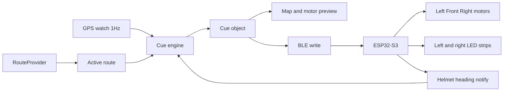

# Smart Helmet Navigation App

The phone is the navigator. The helmet is the actuator. [README.md](README.md) already fixes the hardware: ESP32-S3, phone GPS, BLE, and three motors on GPIO 17 (left), 18 (front), and 21 (right). This design changes one point in that README: the phone does not stream raw GPS and a destination for the ESP32 to interpret. The phone resolves the next move, and BLE carries only a small cue packet. Helmet heading still comes back over BLE so a stopped rider gets a facing direction when GPS course is unreliable.

Cycling is the route profile, matching the bicycle turn-signal note in the README. Walking can be a later profile flag on the same engine.

## Runtime loop

One `Cue` object drives both the screen and the helmet. The map never picks a direction on its own.

## App structure

New trees next to the existing KiCad files:

- [mobile/](mobile/) — Expo dev client (Expo Go cannot host BLE or Mapbox), TypeScript
- [firmware/](firmware/) — PlatformIO Arduino sketch for ESP32-S3
- [shared/cue-protocol.md](shared/cue-protocol.md) — the byte layout both sides copy

Mobile modules:

- `src/routing/types.ts` — `Place`, `Route`, `Step` (geometry, maneuver location, type, modifier, inbound and exit bearings)
- `src/routing/mapbox.ts` — primary provider
- `src/routing/openRouteService.ts` — fallback when no Mapbox token is set
- `src/routing/select.ts` — session choice
- `src/nav/engine.ts` — snap, lookahead, direction bucket, reroute
- `src/nav/geo.ts` — haversine, bearing, cross-track and along-track projection
- `src/location/watch.ts` — continuous high-accuracy fixes
- `src/ble/protocol.ts` and `src/ble/helmet.ts` — scan, connect, write cue, subscribe to heading
- `src/ui/` — map, search, cue preview

## Which map tool

A `RouteProvider` hides the vendor. Selection at session start:

- **Mapbox Directions** when `MAPBOX_ACCESS_TOKEN` is present. This is the default because one vendor covers cycling directions, maneuver bearings, geocoding, and the map. Turn types and modifiers map cleanly onto three motors.
- **OpenRouteService** cycling directions otherwise, so a missing token still produces a route. Its polyline is drawn on the same Mapbox map (or a plain MapLibre view if there is no Mapbox token at all).
- A third provider can be added by implementing `search()` and `route()` only. Google stays out of the default path: Google route results have to be shown on a Google map, which would fork the visualization.

The route is requested once when the rider confirms a destination, then again only when they leave the corridor. Location updates do not call the map API.

## Continuous location and the decision point

`expo-location` watches at about 1 Hz with best accuracy. `expo-keep-awake` holds the demo screen on. Android uses a foreground-service notification so cues continue if the phone is pocketed; iOS uses while-in-use location plus the background location mode.

Heading used for the bucket:

- Speed at least 2 m/s: GPS course (direction of travel along the road).
- Slower or stopped: helmet IMU heading from the BLE notify. Phone compass is ignored because the phone is not facing forward.

On each fix the engine:

1. Projects the fix onto the current step polyline.
2. Counts a reroute after three fixes more than 30 m off the route. The previous cue clears immediately so the helmet does not keep buzzing a stale turn.
3. Treats the end of the step as the decision point. `depart` is not a cue. `arrive` is a distinct short front pattern, then navigation ends.
4. Opens the cue window when remaining distance is under `clamp(speed * 5s, 25m, 80m)`.
5. Chooses the angle. If the provider maneuver is left, right, straight, or uturn and the rider's heading is within 45 degrees of that step's inbound bearing, use the provider. Otherwise use the geometric bearing from the snapped point to a point about 15 m past the junction, minus current heading.
6. Buckets that angle onto the motors: within 30 degrees is front, negative is left, positive is right, beyond 150 degrees is a u-turn pattern (left and right alternating, since there is no rear motor).
7. Drops the cue once the junction is passed and the next step is current.

Straight links stay quiet. A front pulse happens only inside the decision window, so the rider is not buzzed for the whole block. Inside the window, pulse period shrinks from about 800 ms to 200 ms as the junction gets closer. Intensity stays moderate; the MODE button can later scale it, but the first version uses a fixed level.

Indoor hackathon fallback: a simulate control advances a synthetic fix along the polyline so the map, the cue, and the motors can be shown without a street ride.

## Visualization

Full-screen map during navigation:

- Remaining route in a strong color, traveled portion dimmed.
- Rider puck rotated to the heading actually used for the bucket, labeled GPS course or helmet IMU.
- Marker on the next decision point. A ring around the puck represents the lookahead distance.
- Bottom card: destination search, provider name, instruction text, meters to the junction, and a three-dot motor diagram. The dot that matches `Cue.direction` lights on every cue change, including the simulator.
- Status row: BLE connected or not, last heading age, off-route or rerouting banner.

Flow on screen: idle search, route preview with start, navigating, arrived. Rerouting replaces the banner and then redraws the polyline without leaving the navigating screen.

The ESP32 also mirrors left and right cues onto the existing WS2812 sections (GPIO 10 and 11 through the level shifter) so a judge can see the turn when the phone is in a pocket. Front-only cues leave the strips off. Those LEDs are a copy of `Cue.direction`, not a second decision.

## Bluetooth

Phone is central. Helmet advertises as a peripheral named `SmartHelmet`.

Custom service, little-endian packets, duplicated in `mobile/src/ble/protocol.ts` and `firmware/include/protocol.h`.

Cue, phone to helmet, write without response, 8 bytes: version, direction (`0` none, `1` left, `2` front, `3` right, `4` uturn), intensity, pulse period in ms as `u16`, distance in meters as `u16`, flags (arrived, off-route, rerouting). Rewrite when the cue changes, and about once per second while a cue is active so a dropped packet recovers.

Helmet state, helmet to phone, notify: heading in decidegrees (`0`–`3599`, or `0xFFFF` if invalid), a valid flag, and a button bitfield. About 5 Hz is enough. The phone does not send the route or a GPS stream.

Firmware behavior: BLE server, LEDC PWM on GPIO 17 / 18 / 21 for the three MOSFET gates, I2C heading from the LSM6DSOX accelerometer and gyro plus LIS3MDL magnetometer (tilt-compensated complementary filter). If the IMU fails, heading is marked invalid and the phone uses GPS course only; motors still play the cue. A cue older than 2 seconds stops the motors.

## Hardware integration and React Native

React Native never touches GPIO, the IMU, or the motor MOSFETs. Those stay in the ESP32 sketch. The phone only writes an 8-byte cue and subscribes to heading, which is a normal BLE central role for `react-native-ble-plx`. Location is `expo-location`, a first-party Expo API. Switching the phone to Kotlin or Flutter would leave the firmware work the same size.

The phone-side friction is setup, not the hardware protocol: a custom dev build instead of Expo Go, Android 12 Nearby-devices permission plus location, and the iOS Bluetooth usage string so the scan does not fail silently. The firmware advertises again after disconnect, and the phone rewrites the active cue about once a second, so a dropped link recovers without a new route.

The harder hardware piece is helmet firmware: a BLE peripheral, PWM on the three gates, and a tilt-compensated heading from the LSM6DSOX and LIS3MDL. That code is Arduino on the ESP32-S3 and does not import the React Native app. Motors still run if the magnetometer heading is invalid.

## Deploying onto different phones

One TypeScript app, two native binaries. Expo Go cannot install this app, because BLE (`react-native-ble-plx`) and the map (`@rnmapbox/maps`) are native modules. Each phone needs a custom build. The helmet firmware is flashed once over USB and is not part of the phone install. Any phone running the app can connect to that helmet, and only one phone should connect at a time.

Hackathon install, which is what teammates and judges should use, bundles the JavaScript inside the binary so the phone works with no laptop nearby.

- **Android.** Build one release APK (`eas build -p android --profile preview`, or `./gradlew assembleRelease` after `expo prebuild`). Share that file. On the phone, allow install from unknown sources and open the APK. The same arm64 APK covers current Android phones. Android 12 and newer prompt for Nearby devices as well as location.
- **iPhone.** Needs an Apple signing identity. Fastest weekend path: a Mac, Xcode, and a free Apple ID, plugged in once (`eas build -p ios` or `expo run:ios --device`). That install lasts about 7 days and only works on phones registered from that Mac. With a paid Apple Developer account, upload the same EAS build to TestFlight and each iPhone installs it from the TestFlight app with no cable.
- **Person who is coding.** USB plus `expo run:android` or `expo run:ios` and a Metro bundler. That is a development install, not the copy to hand around.

Mapbox tokens are locked to the app id. Register both the Android `applicationId` and the iOS bundle identifier on the token, or the map is blank on one platform while routing still works. Put the token in EAS secrets or a local untracked env file, not in git. If a phone has no working Mapbox token, OpenRouteService still supplies the route.

First launch on every phone asks for location and Bluetooth. Deny either one and cues cannot run. Keep the screen unlocked for the demo, or accept the Android foreground-service notification so buzzing continues in a pocket.

## README

Update the navigation bullet in [README.md](README.md) so it matches this split: phone route and GPS, BLE cue toward the helmet, IMU heading back toward the phone.

## Prize-track add-ons

Prize list checked from the live Cal Hacks feed on Oct 23, 2026. The helmet already fits Hardware, People-First, and a hands-free safety demo. The add-on below is how the unrelated sponsor tracks attach without letting a model command the motors.

Shared piece: a Ride Agent next to the cue engine. The engine still chooses left, front, right, or u-turn. The agent may speak, remember, fetch road alerts, notify a friend, and write an audit log. It cannot change `Cue.direction`.

Hours below are for one person after the phone is already producing a `Cue`. They do not include the base app. The base app is the long pole: about 24–40 hours split across phone, map, and firmware. Add-ons that need a server or a second phone lose the demo if that piece fails, so the cue engine has to keep working without them.

Weekend stack if we only build one layer: Convex ride log (3–5 h, high prize value, medium rider value), one LLM narrator (2–3 h, high story value), and an Apify closure scraper (5–8 h, high rider value if a closure actually reroutes). Voice is 4–6 h on the phone speaker, or 8–12 h if audio comes off the helmet mic. Everything else is an alternate plug-in or a pitch on top of that log.

- Meta connection: 3–4 h on top of Convex. A friend opens a live status page. Rider impact is social, not navigational. Prize fit is medium because "closer together" needs a real second person in the demo.
- Nessie: 3–5 h. Reads sandbox purchases near the route and suggests one affordable stop. Rider impact is low. Prize fit is low unless Nessie is the center of the demo.
- Factory Droid: 5–8 h. Post-ride, Droid proposes a threshold change and shows the plan. Rider impact shows up on the next ride. Prize fit is medium if the diff is real and visible.
- Fetch.ai: 4–6 h. Two uAgents replace the scraper. Same rider effect as a closure alert. Prize fit is medium. Build this instead of Apify, not beside it.
- Coinbase x402: 6–10 h. Hazard API returns 402, agent pays a capped test amount, stores the receipt. Rider impact is invisible. Prize fit is medium and the live payment is a demo risk.
- CRS: 4–6 h. Sandbox identity check before a loaner helmet pairs. Rider impact is a gate at checkout. Prize fit is medium for "unexpected" and identity, low for the fintech grand prize.
- Hyphenate: 2–3 h of audit UI on the Convex log. Prize is large, fit is low, because the brief is finance seats. Use the log in the pitch and do not build a finance product.
- Microsoft: 1–2 h of the same audit in the pitch. Fit is medium-high: commute safety counts as a high-impact domain, and the model limit is the responsible-design story. Depends on the base demo working.
- Cartesia, ElevenLabs, or Moss: 4–6 h for phone text-to-speech of the current cue, plus a tap-to-talk "what's next." Helmet-mic audio is 8–12 h and easy to lose. Pick Cartesia if chasing their brief. ElevenLabs and Moss are the same slot.
- One LLM (Anthropic, Bitdeer, Gemini, Snowflake, or a generic gen-AI API): 2–3 h for the first, about 1 h to swap the endpoint. Rider hears or reads one sentence. Prize fit is high for Anthropic's "named community and known failure" criteria, and the others are the same call entered in a second category.
- Convex: 3–5 h. Best database prize-to-time ratio. SpacetimeDB is 5–8 h for the same live sync. MongoDB is 4–6 h. Tiger Data is 5–8 h and only wins if we need time-series charts. Pick one.
- Apify: 5–8 h, including a published actor. Bright Data is the same work on their API. Rider impact is high when a closure changes the polyline on stage. Prize fit is high because the product breaks if the feed is removed.
- Backboard: 2–4 h for memory of buzz strength and quiet hours. Rider impact is medium on a second ride. Prize is small. Skip if Convex already stores preferences.
- Auth0: 2–3 h, only for multi-phone history. Low rider impact.
- Vultr or DigitalOcean: 2–3 h to host the scraper. Skip if the scraper runs on the demo laptop.
- Figma: 2–4 h for a prototype and a stage log, in parallel with UI. No rider change. Worth it if someone is designing anyway.
- Atlassian Forge: 8–14 h including their CLI and demo site. Files a Jira ticket from a late cue. No rider impact. Poor time trade.
- Creao: criteria doc did not open. Do not schedule it until we know they require the Creao product. Cash is real, fit is unknown.
- Solana, Visa shopping, and Presage: 6–12 h each, low rider fit, leave out. Armadin, Elastic, AfterQuery, and Annapurna had no criteria yet.
- Free entries with no product code: Notability notes during the build, a .tech or GoDaddy domain, the SpaceXSI Cursor plus Grok Bot raffle, and the Commit Fellowship opt-in.

## Out of scope for this pass

Microphone commands, SOS flow, and hard-iron magnetometer calibration. GPIO 8 and 9 can be read into the button bitfield without changing navigation.